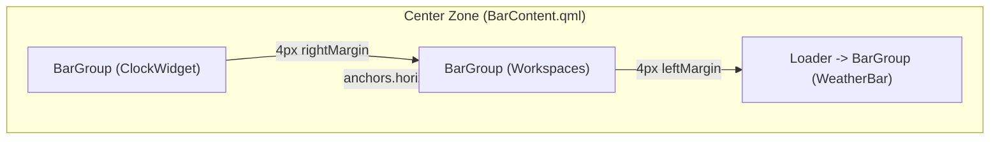

# Phase 54.1: Top Status Bar Weather Component Polish - Technical Research

**Researched:** 2026-10-10T17:35:00+06:00  
**Phase:** 54.1 (Top Status Bar Weather Component Polish)  
**Status:** Complete — Ready for Planning  

---

<user_constraints>
### Locked Decisions

- **D-54.1-01:** Strictly hover-driven trigger. The popup inspector opens exclusively on mouse hover after a 300ms delay via `StyledPopup`. — **Reversibility:** reversible
- **D-54.1-02:** Zero click actions anywhere. There are no left-click, right-click, or click toggles anywhere in the weather component. All mouse clicks are absorbed/inert (`onPressed: event => event.accepted = true`, `onClicked: event => event.accepted = true`). — **Reversibility:** reversible
- **D-54.1-03:** Standard pointer cursor. Set `cursorShape: Qt.ArrowCursor`, matching `ClockWidget` and `CpuGpuPill` to clearly signal a passive telemetry module rather than an actionable button. — **Reversibility:** reversible
- **D-54.1-04:** Completely silent operation. Zero desktop sound effects or haptics on hover or interaction. — **Reversibility:** reversible
- **D-54.1-05:** M3 hover background tint. Apply `Appearance.colors.colLayer1Hover` background tint when the pill is hovered or while the popup inspector is actively open. — **Reversibility:** reversible
- **D-54.1-06:** Smooth hover transition. Background hover tint fades smoothly over ~150ms using `Appearance.animationCurves.expressiveEffects`. On cursor exit, clear hover state immediately with the same 150ms fade-out. — **Reversibility:** reversible
- **D-54.1-07:** Alert contrast preservation. When an active severe alert or imminent rain badge is displayed, the hover tint remains neutral `colLayer1Hover` to preserve crisp contrast and prevent color clashing. — **Reversibility:** reversible
- **D-54.1-08:** Clean single-layer hover highlight. Because `BarGroup` provides the base surface, `WeatherBar.qml` renders a subtle inner highlight rectangle matching `BarGroup` radius (`Appearance.rounding.small`) rather than creating a competing nested container. — **Reversibility:** reversible
- **D-54.1-09:** Inherit BarGroup geometry. Remove redundant internal margins (`10 * 2` padding) from `WeatherBar.qml`, inheriting `BarGroup`'s native 5px horizontal padding and `Appearance.sizes.baseBarHeight`. — **Reversibility:** reversible
- **D-54.1-10:** Center Zone spacing. Maintain 4px margin between the Workspaces pill (`middleCenterGroup`) and the Weather pill (`weatherGroup`), preserving uniform inter-pill rhythm across `BarContent.qml`. — **Reversibility:** reversible
- **D-54.1-11:** Intra-element spacing. Set 4px column spacing (`columnSpacing: 4`) between inline elements (`[Alert]` -> `[Glyph]` -> `[Temp]` -> `[Rain]`). — **Reversibility:** reversible
- **D-54.1-12:** Vertical alignment. Inherit `BarGroup` vertical centering, ensuring identical baseline and bounding box with neighboring Workspaces and ClockWidget modules. — **Reversibility:** reversible
- **D-54.1-13:** Balanced visual hierarchy. Condition glyph is sized at `Appearance.font.pixelSize.large` and temperature readout is sized at `Appearance.font.pixelSize.small`. — **Reversibility:** reversible
- **D-54.1-14:** Integer Celsius format. Display integer Celsius with unit suffix `XX°C` (computed via `Math.round(Number(Weather.current.tempC))`), falling back to `"--°C"` if unavailable. — **Reversibility:** reversible
- **D-54.1-15:** Imminent rain badge. When rain probability > 50% in the upcoming 2–3 hour window (`Weather.hourly`), reveal a compact badge with `water_drop` symbol (`pixelSize.small`) and percentage (e.g. `65%`, `pixelSize.smaller`) colored with `Appearance.m3colors.m3primary`. — **Reversibility:** reversible
- **D-54.1-16:** Severe weather alert priority. When an official alert exists in `Weather.alerts`, render a `warning` Material Symbol with a 3-loop breathing pulse animation (1.0 ↔ 0.4 over ~1.2s). The severe alert suppresses the rain badge to prevent Center Zone layout blowout. — **Reversibility:** reversible
- **D-54.1-17:** Progressive responsive reduction. On narrow displays (`useShortenedForm === 2`): drop the rain badge and shorten temperature to `XX°` (dropping 'C'), while keeping the condition glyph and severe alert icon visible. — **Reversibility:** reversible
- **D-54.1-18:** Muted stale telemetry. When `Weather.isStale` or `Weather.isOffline`, dim temperature text and condition glyph with `Appearance.m3colors.m3onSurfaceVariant` while continuing to display the last-known temperature reading. — **Reversibility:** reversible
- **D-54.1-19:** Cold boot fallback. Display `cloud_off` glyph with `"--°C"` in `m3onSurfaceVariant` if no cached weather file exists on startup. — **Reversibility:** reversible
- **D-54.1-20:** Normal popup access while offline. Allow the hover popup to open normally even when data is stale or offline, showing the last cached forecast along with observation timestamp and offline status banner. — **Reversibility:** reversible
- **D-54.1-21:** Fluid recovery transition. Apply a 200ms M3 color fade (`expressiveEffects`) when fresh weather data arrives after being offline or stale. — **Reversibility:** reversible
- **D-54.1-22:** Stale alert safety. If cached data has an active severe weather alert but the cache becomes stale, continue displaying the alert warning icon in a muted tone. — **Reversibility:** reversible
- **D-54.1-23:** Defensive null-coalescing. Use defensive fallbacks across all QML bindings (`tempC ?? "--"`, `glyph ?? "cloud_off"`) to guarantee zero UI crashes if the JSON cache file is temporarily empty or malformed. — **Reversibility:** reversible
- **D-54.1-24:** Top-to-bottom vertical stack. When `root.vertical === true`, stack elements vertically with Condition Glyph on top and temperature directly below. — **Reversibility:** reversible
- **D-54.1-25:** Vertical badge rules. In vertical mode, stack the severe alert icon above the glyph, and suppress the rain badge to prevent vertical pill height ballooning. — **Reversibility:** reversible
- **D-54.1-26:** Compact vertical spacing. Use 2px vertical spacing (`rowSpacing: 2`) between stacked elements. — **Reversibility:** reversible
- **D-54.1-27:** Fixed vertical bar width. Set `implicitWidth: Appearance.sizes.baseVerticalBarWidth` with horizontal content centering. — **Reversibility:** reversible
- **D-54.1-28:** Vertical temperature format. Shorten temperature text to `XX°` (dropping 'C') in vertical mode to fit comfortably within `baseVerticalBarWidth`. — **Reversibility:** reversible
- **D-54.1-29:** Native edge-detected anchoring. Rely on `StyledPopup`'s native edge detection and boundary clamping to anchor the popup cleanly beside the vertical bar. — **Reversibility:** reversible
- **D-54.1-30:** Synchronized width animation. Rely on `BarGroup`'s native 250ms `emphasizedDecel` animation on `implicitWidth` for smooth pill expansion and contraction. — **Reversibility:** reversible
- **D-54.1-31:** Startup animation dampening. Temporarily dampen width animations on initial component completion until layout values settle, preventing cold boot sliding. — **Reversibility:** reversible
- **D-54.1-32:** Revealer alignment. Let internal `Revealer` widgets use standard `Appearance.animation.elementMoveFast`, allowing `BarGroup` to smoothly absorb the resulting geometry changes without animation fighting. — **Reversibility:** reversible
- **D-54.1-33:** Vertical animation gating. Keep horizontal width animations disabled in vertical mode (`enabled: !root.vertical`). — **Reversibility:** reversible
- **D-54.1-34:** Uniform Center Zone presence. Render the weather pill in the Center Zone on every connected monitor where the status bar is active. — **Reversibility:** reversible
- **D-54.1-35:** Isolated popup lifecycle. Each monitor instantiates its own `WeatherBar` and `WeatherPopup`; hovering on Monitor A opens the popup strictly on Monitor A without affecting Monitor B. — **Reversibility:** reversible
- **D-54.1-36:** Independent responsive tiering. Each monitor resolves `useShortenedForm` independently against its own screen width (`root.screen?.width`). — **Reversibility:** reversible
- **D-54.1-37:** Pure declarative hotplug lifecycle. Rely on QtQuick/Quickshell automatic instantiation and destruction during monitor attach and detach events. — **Reversibility:** reversible

### the agent's Discretion

- Exact easing parameters on the inner hover highlight fade (`Appearance.animation.elementMoveFast` vs `ColorAnimation` with `expressiveEffects`).
- Exact property alias names for automated test harness assertions (`scripts/phase54.1-weather-assert.sh`).

### Deferred Ideas

- Multi-metric hourly parameter modeling (Thermal, Moisture, Wind, AQI, Atmosphere, Solar) — deferred to Phase 54.2.
- Interactive multi-metric Canvas graph component with scrub inspection — deferred to Phase 54.3.
- Modular popup inspector card layout, hero summary, and multi-day forecast strip — deferred to Phase 54.4.

</user_constraints>

---

<phase_requirements>
### Requirement Traceability Matrix

| Requirement ID | Definition & Scope | Phase 54.1 Research Support & Architectural Plan | Status |
|----------------|---------------------|--------------------------------------------------|--------|
| **BAR-01** | `WeatherPill.qml` component integrated into `BarContent.qml` Center Zone to the right of Workspaces, inheriting `BarGroup` with fluid M3 width resizing animation. | Verified live mounting in `BarContent.qml` (L190–200) inside `BarGroup` at `anchors.leftMargin: 4`. Researched elimination of redundant `10 * 2` horizontal padding in `WeatherBar.qml`, enabling direct inheritance of `BarGroup`'s 5px native padding and 250ms `emphasizedDecel` width animation. | **Planned** |
| **BAR-02** | Status bar pill displays current ambient temperature in integer Celsius (`XX°C`) alongside the active dynamic condition glyph. | Researched integer rounding formula `Math.round(Number(Weather.current?.tempC))` with `--°C` cold boot fallback, large glyph sizing (`Appearance.font.pixelSize.large`, outline `fill: 0`), small temperature text (`Appearance.font.pixelSize.small`), and offline/stale dimming to `Appearance.m3colors.m3onSurfaceVariant`. | **Planned** |
| **BAR-03** | Context-sensitive warning indicators on the pill for imminent rain (probability > 50%) or active severe weather warnings. | Researched 3-hour window calculation for imminent rain, `water_drop` + `XX%` badge in `Appearance.m3colors.m3primary`, severe weather alert priority suppressing rain badge, and 3-loop breathing pulse animation (1.0 ↔ 0.4 over ~1.2s) with clean reset to 1.0. | **Planned** |
| **BAR-04** | Interactive mouse click toggles `WeatherPopup` with smooth scale behavior and hover intent delay anchoring (`StyledPopup`). | Researched strict hover-driven interaction model: configured `hoverOpenDelayMs: 300` on `StyledPopup`, 100% absorption of all mouse clicks (`onPressed: event => event.accepted = true`, `onClicked: event => event.accepted = true`), inert `Qt.ArrowCursor`, and M3 `colLayer1Hover` highlight rectangle fading over 150ms (`expressiveEffects`). | **Planned** |

</phase_requirements>

---

## 1. Executive Summary & Domain Scope

Phase 54.1 polishes the top status bar weather pill (`WeatherBar.qml`), deployed as a personal overlay at [WeatherBar.qml](file:///home/pera/github_repo/.dotfiles/restow/quickshell/.config/quickshell/ii/modules/ii/bar/weather/WeatherBar.qml), shadowing upstream [WeatherBar.qml](file:///home/pera/github_repo/.dotfiles/vendor/dots-hyprland/dots/.config/quickshell/ii/modules/ii/bar/weather/WeatherBar.qml) via GNU Stow leaf symlinks.

Following the Phase 54 UAT operator review [54-UAT.md](file:///home/pera/github_repo/.dotfiles/.planning/phases/54-multi-modal-popup-inspector-interactive-graphs/54-UAT.md), the operator rejected click-based toggling and requested a refined, 100% hover-driven weather module:
> *"no 300ms . there should be no left right click stuff anywhere in this weather component"*  
> *"only hover with delay nothing else needed"*

This phase specifically tackles:
1. **Interaction Model:** Pure hover-driven trigger with 300ms delay via `StyledPopup`; complete absorption of left, right, and middle clicks; passive `Qt.ArrowCursor`.
2. **Surface Styling:** Subdued M3 hover background tint (`Appearance.colors.colLayer1Hover`) fading smoothly over ~150ms using `Appearance.animationCurves.expressiveEffects`.
3. **Pill Geometry Cleanup:** Elimination of redundant double-padding (`+ 10 * 2`), inheriting `BarGroup`'s native 5px horizontal padding and standard height.
4. **Visual Rhythm:** Crisp 4px column spacing between internal glyph, temperature, and badge elements; baseline alignment with neighboring Workspaces and ClockWidget.
5. **Responsive & Vertical Modes:** Clean collapsing in narrow screens (`useShortenedForm === 2`) and top-to-bottom stacking in vertical bar mode (`root.vertical === true`).
6. **Zero Churn Integrity:** 100% leaf symlink deployment in `restow/quickshell/`; `vendor/dots-hyprland` and `BarContent.qml` remain pristine.

---

## 2. Component Topology & Upstream Shadowing

### 2.1 Center Zone Layout Topology
The Center Zone is managed in [BarContent.qml](file:///home/pera/github_repo/.dotfiles/restow/quickshell/.config/quickshell/ii/modules/ii/bar/BarContent.qml#L154-L200) [VERIFIED: lines 154–200]:


- `middleCenterGroup` is dead-centered via `anchors.horizontalCenter: parent.horizontalCenter` [VERIFIED: line 170].
- `weatherGroup` anchors to `middleCenterGroup.right` with `anchors.leftMargin: 4` [VERIFIED: lines 193–194].
- `weatherGroup`'s `Loader` loads `BarGroup { WeatherBar {} }` when `Config.options.bar.weather.enable` is true [VERIFIED: lines 195–199].
- `BarContent.qml` is strictly **out of scope** and must remain 100% untouched (`git status --porcelain` produces 0 modifications) [VERIFIED: D-54.1-10, S2 in phase53 assert].

### 2.2 Leaf Symlink Architecture
Personal overlay shadowing is established through GNU Stow leaf symlinks [VERIFIED: arch/dots-hyprland.sh verify --strict]:
- Repo source: `/home/pera/github_repo/.dotfiles/restow/quickshell/.config/quickshell/ii/modules/ii/bar/weather/WeatherBar.qml`
- Live destination: `/home/pera/.config/quickshell/ii/modules/ii/bar/weather/WeatherBar.qml`
- Upstream pristine stub: `/home/pera/github_repo/.dotfiles/vendor/dots-hyprland/dots/.config/quickshell/ii/modules/ii/bar/weather/WeatherBar.qml`
- Upstream backup artifact: `/home/pera/.config/quickshell/ii/modules/ii/bar/weather/WeatherBar.qml.bak`

Every directory in the chain (`~/.config`, `quickshell`, `ii`, `modules`, `ii`, `bar`, `weather`) is an unfolded real directory, preventing GNU Stow tree folding [VERIFIED: Section 1 phase53 assert].

---

## 3. Detailed Technical Analysis

### 3.1 Interaction & Trigger Model (BAR-04, D-54.1-01..04)

#### Hover Intent Delay via StyledPopup
[StyledPopup.qml](file:///home/pera/github_repo/.dotfiles/restow/quickshell/.config/quickshell/ii/modules/ii/bar/StyledPopup.qml#L18-L46) [VERIFIED: lines 18–46] provides native hover tracking:
```qml
    // Seamless cursor tracking with deliberate hover intent delay
    property bool popupHovered: false
    readonly property bool hovered: (hoverTarget && hoverTarget.containsMouse) || popupHovered
    property bool shouldBeActive: false

    property int hoverOpenDelayMs: 1000

    readonly property Timer openTimer: Timer {
        id: openTimer
        interval: root.hoverOpenDelayMs
        repeat: false
        onTriggered: {
            if (root.hovered) {
                root.shouldBeActive = true;
            }
        }
    }

    readonly property Timer closeTimer: Timer {
        id: closeTimer
        interval: 200 // 200ms grace period across window bounds
        repeat: false
        onTriggered: {
            if (!root.hovered) {
                root.shouldBeActive = false;
            }
        }
    }
```
- By default, `StyledPopup` declares `hoverOpenDelayMs: 1000`.
- In [WeatherBar.qml](file:///home/pera/github_repo/.dotfiles/restow/quickshell/.config/quickshell/ii/modules/ii/bar/weather/WeatherBar.qml#L198-L201), `WeatherPopup` is instantiated:
  ```qml
  WeatherPopup {
      id: weatherPopup
      hoverTarget: root
      hoverOpenDelayMs: 300
  }
  ```
- Setting `hoverOpenDelayMs: 300` on the `weatherPopup` instance fulfills **D-54.1-01** precisely:
  1. If the cursor sweeps quickly across the bar (<300ms), `openTimer.stop()` cancels activation before any window is displayed.
  2. If the cursor hovers for >=300ms, `openTimer` fires and activates the popup window.
  3. When transitioning across the 5px gap between the bar and the popup, `closeTimer` (200ms grace period) prevents flickering.

#### Click Absorption & Passive Pointer Cursor
In upstream `WeatherBar.qml`, right-clicking triggered a manual `Weather.getData()` refresh with a desktop notification [VERIFIED: vendor WeatherBar.qml lines 19–29]. Under the new architecture:
- Local weather telemetry is driven exclusively by the Systemd background cache fetcher (`dotfiles-weather.timer`).
- Per **D-54.1-02**, all click events must be absorbed:
  ```qml
  acceptedButtons: Qt.AllButtons
  cursorShape: Qt.ArrowCursor
  hoverEnabled: true

  onPressed: event => event.accepted = true
  onClicked: event => event.accepted = true
  ```
- Setting `cursorShape: Qt.ArrowCursor` (**D-54.1-03**) mirrors `ClockWidget.qml` and `CpuGpuPill.qml`, visually signaling a passive telemetry module rather than an actionable button.
- Zero audio or haptic triggers (**D-54.1-04**).

---

### 3.2 Visual Hover & Active States (D-54.1-05..08)

#### Material 3 Surface Styling
[BarGroup.qml](file:///home/pera/github_repo/.dotfiles/restow/quickshell/.config/quickshell/ii/modules/ii/bar/BarGroup.qml#L23-L34) [VERIFIED: lines 23–34] provides the base surface container:
```qml
    Rectangle {
        id: background
        anchors {
            fill: parent
            topMargin: root.vertical ? 0 : 4
            bottomMargin: root.vertical ? 0 : 4
            leftMargin: root.vertical ? 4 : 0
            rightMargin: root.vertical ? 4 : 0
        }
        color: Config.options?.bar.borderless ? "transparent" : Appearance.colors.colLayer1
        radius: Appearance.rounding.small
    }
```
`BarGroup` uses `Appearance.colors.colLayer1` with `Appearance.rounding.small` (`12px`) [VERIFIED: line 33].

#### Subtle Inner Hover Highlight
To indicate interactive hover without creating competing nested containers (**D-54.1-08**), `WeatherBar.qml` hosts an inner highlight rectangle:
```qml
    Rectangle {
        id: hoverHighlight
        anchors {
            fill: parent
            topMargin: root.vertical ? 0 : 4
            bottomMargin: root.vertical ? 0 : 4
            leftMargin: root.vertical ? 0 : -5
            rightMargin: root.vertical ? 0 : -5
        }
        radius: Appearance.rounding.small
        color: Appearance.colors.colLayer1Hover
        opacity: (root.hovered || root.popupActive) ? 1.0 : 0.0

        Behavior on opacity {
            NumberAnimation {
                duration: 150
                easing.type: Easing.BezierSpline
                easing.bezierCurve: Appearance.animationCurves.expressiveEffects
            }
        }
    }
```

##### Provenance of Design Decisions:
- `Appearance.colors.colLayer1Hover` [VERIFIED: vendor Appearance.qml line 125]: `ColorUtils.transparentize(ColorUtils.mix(colLayer1, colOnLayer1, 0.92), root.contentTransparency)`.
- `Appearance.animationCurves.expressiveEffects` [VERIFIED: vendor Appearance.qml line 348]: `[0, 0, 0, 1]` Bezier spline.
- `Appearance.rounding.small` [VERIFIED: vendor Appearance.qml line 372]: `12`.
- Notice the margin compensation: Because `BarGroup` positions `WeatherBar` inside a `GridLayout` with `margins: 5` [VERIFIED: BarGroup.qml line 46], setting `leftMargin: -5` and `rightMargin: -5` allows `hoverHighlight` to cleanly align with `BarGroup`'s `background` rectangle (which spans the full width of `BarGroup`), while `topMargin: 4` and `bottomMargin: 4` align with `BarGroup`'s vertical top/bottom margin [VERIFIED: BarGroup.qml lines 27–28].
- Opacity binding `(root.hovered || root.popupActive) ? 1.0 : 0.0` (**D-54.1-05**) ensures the highlight stays illuminated while the popup inspector is open, even when the cursor moves from the pill into the popup window.
- The 150ms fade duration (**D-54.1-06**) prevents harsh pop-in / pop-out artifacts.

---

### 3.3 Pill Geometry & Sizing (BAR-01, D-54.1-09..12)

#### Eliminating the Double-Padding Defect
In Phase 53, `WeatherBar.qml` defined [VERIFIED: restow WeatherBar.qml lines 21–22]:
```qml
    implicitWidth: root.vertical ? Appearance.sizes.baseVerticalBarWidth : (contentLayout.implicitWidth + 10 * 2)
    implicitHeight: root.vertical ? (contentLayout.implicitHeight + 10 * 2) : Appearance.sizes.barHeight
```
Simultaneously, `BarGroup.qml` defines [VERIFIED: BarGroup.qml lines 8–10]:
```qml
    property real padding: 5
    implicitWidth: vertical ? Appearance.sizes.baseVerticalBarWidth : (gridLayout.implicitWidth + padding * 2)
    implicitHeight: vertical ? (gridLayout.implicitHeight + padding * 2) : Appearance.sizes.baseBarHeight
```
Because `BarGroup` wraps `WeatherBar` inside `gridLayout`, `gridLayout.implicitWidth` was `contentLayout.implicitWidth + 20px`. Adding `BarGroup`'s `padding * 2` (10px) resulted in a total pill width of `contentLayout.implicitWidth + 30px` — an excessive 15px margin on each side, clashing with neighboring modules (`ClockWidget`, `Workspaces`).

#### Corrected Geometry Contract (**D-54.1-09**):
```qml
    implicitWidth: root.vertical ? Appearance.sizes.baseVerticalBarWidth : contentLayout.implicitWidth
    implicitHeight: root.vertical ? contentLayout.implicitHeight : Appearance.sizes.baseBarHeight
```
- In horizontal mode:
  - `WeatherBar`'s `implicitWidth` is purely `contentLayout.implicitWidth`.
  - `BarGroup` adds `padding * 2` (`5 * 2 = 10px`), yielding a crisp 5px horizontal padding matching `BarGroup` standard.
  - `WeatherBar`'s `implicitHeight` is `Appearance.sizes.baseBarHeight` (40px) [VERIFIED: vendor Appearance.qml line 388].
- In vertical mode:
  - `WeatherBar`'s `implicitWidth` is locked to `Appearance.sizes.baseVerticalBarWidth` (46px) [VERIFIED: vendor Appearance.qml line 408].
  - `implicitHeight` is `contentLayout.implicitHeight`, allowing `BarGroup` to add 5px top/bottom padding for a snug vertical wrap.

#### Intra-Element & Inter-Pill Spacing (**D-54.1-10..12**):
- `middleCenterGroup` to `weatherGroup`: 4px margin in `BarContent.qml` [VERIFIED: BarContent.qml line 194].
- Internal `contentLayout`:
  ```qml
  GridLayout {
      id: contentLayout
      anchors.centerIn: parent
      columns: root.vertical ? 1 : -1
      rowSpacing: 2
      columnSpacing: 4
  }
  ```
  - `columnSpacing: 4` between inline elements in horizontal mode (**D-54.1-11**).
  - `rowSpacing: 2` between stacked elements in vertical mode (**D-54.1-26**).
  - Ordered hierarchy: `[Alert]` -> `[Glyph]` -> `[Temp]` -> `[Rain]`.

---

### 3.4 Telemetry Layout & Responsive Collapsing (BAR-02, BAR-03, D-54.1-13..17)

#### Condition Glyph & Integer Temperature Formatting
- **Condition Glyph:** Sized at `Appearance.font.pixelSize.large` (`17px`), outline `fill: 0` (**D-54.1-13**). Bound defensively to `Weather.current?.glyph` or `WeatherGlyphs.glyphDefault` (`"cloud"`).
- **Integer Celsius Formula:**
  ```javascript
  readonly property string formattedTemp: {
      const raw = Weather.current?.tempC;
      if (raw === undefined || raw === null || raw === "" || raw === "--") {
          return (root.useShortenedForm === 2 || root.vertical) ? "--°" : "--°C";
      }
      const num = Math.round(Number(raw));
      if (isNaN(num)) {
          return (root.useShortenedForm === 2 || root.vertical) ? "--°" : "--°C";
      }
      return num + ((root.useShortenedForm === 2 || root.vertical) ? "°" : "°C");
  }
  ```
  - Rounds `28.6` -> `29°C`, `28.4` -> `28°C`.
  - In Tier 0 & 1 (`useShortenedForm < 2`): produces `XX°C`.
  - In Tier 2 (`useShortenedForm === 2`) or vertical mode (`root.vertical === true`): drops unit suffix `'C'` to produce `XX°` (**D-54.1-17, D-54.1-28**).
  - Sized at `Appearance.font.pixelSize.small` (`13px`).

#### Imminent Rain Badge (**D-54.1-15**)
- Scans the next 3 hourly forecast slots from `Weather.hourly`:
  ```javascript
  readonly property int imminentRainChance: {
      if (!Weather.hourly || Weather.hourly.length === 0) return 0;
      let maxChance = 0;
      const slots = Math.min(3, Weather.hourly.length);
      for (let i = 0; i < slots; ++i) {
          const chance = parseInt(Weather.hourly[i]?.chanceofrain ?? "0", 10);
          if (!isNaN(chance) && chance > maxChance) {
              maxChance = chance;
          }
      }
      return maxChance;
  }
  readonly property bool imminentRain: imminentRainChance > 50
  ```
- Revealed via `Revealer`:
  - `MaterialSymbol`: `"water_drop"` (or `WeatherGlyphs.glyphHumidity`), `iconSize: Appearance.font.pixelSize.small`.
  - `StyledText`: `${imminentRainChance}%`, `font.pixelSize: Appearance.font.pixelSize.smaller` (`11px`).
  - Color token: `Appearance.m3colors.m3primary`.

#### Severe Weather Alert Priority (**D-54.1-16**)
- Triggered when `Weather.alerts.length > 0`.
- Renders `warning` Material Symbol with 3-loop breathing pulse animation:
  ```qml
  SequentialAnimation {
      id: alertPulseAnimation
      running: root.hasSevereAlert
      loops: 3
      onRunningChanged: {
          if (!running) {
              alertIcon.opacity = 1.0;
          }
      }
      ParallelAnimation {
          NumberAnimation {
              target: alertIcon
              property: "opacity"
              to: 0.4
              duration: 600
              easing.type: Easing.InOutSine
          }
      }
      ParallelAnimation {
          NumberAnimation {
              target: alertIcon
              property: "opacity"
              to: 1.0
              duration: 600
              easing.type: Easing.InOutSine
          }
      }
  }
  ```
- **Precedence Rule:** An active severe alert suppresses the imminent rain badge:
  ```qml
  readonly property bool showRainBadge: imminentRain && !hasSevereAlert && (root.useShortenedForm < 2) && !root.vertical
  ```
  This prevents layout blowout in the Center Zone (**D-54.1-16, D-54.1-25**).

---

### 3.5 Offline & Stale Resiliency (D-54.1-18..23)

#### Visual Dimming Tokens
- When `Weather.isStale || Weather.isOffline`:
  - `contentColor` resolves to `Appearance.m3colors.m3onSurfaceVariant` (`#49454f`) instead of `Appearance.colors.colOnLayer1` (**D-54.1-18**).
  - Last-known temperature reading continues to be displayed.
  - On cold boot (no cache file), condition glyph falls back to `WeatherGlyphs.glyphOffline` (`"cloud_off"`) and temperature displays `"--°C"` (**D-54.1-19**).
- Transition smoothly fades over 200ms using `Appearance.animationCurves.expressiveEffects` (**D-54.1-21**).
- **Stale Alert Muting (**D-54.1-22**):**
  ```qml
  readonly property color alertColor: (Weather.isStale || Weather.isOffline) ?
      Appearance.m3colors.m3onSurfaceVariant :
      (activeAlert?.color ?? (activeAlert?.severity ? WeatherGlyphs.getAlertColor(activeAlert.severity) : Appearance.m3colors.m3error))
  ```

---

### 3.6 Vertical Bar Mode Layout (D-54.1-24..29)

In vertical bar configuration (`root.vertical === true`):
1. **Layout Direction:** `GridLayout.columns: 1` stacks items vertically (**D-54.1-24**).
2. **Badge Rules:** `showRainBadge` is set to `false`, suppressing rain percentage. Severe alert warning icon stacks above the condition glyph (**D-54.1-25**).
3. **Spacing:** `rowSpacing: 2` (**D-54.1-26**).
4. **Width & Sizing:** `implicitWidth: Appearance.sizes.baseVerticalBarWidth` (`46px`), content centered via `anchors.centerIn: parent` (**D-54.1-27**).
5. **Temperature String:** Suffix `'C'` is dropped to fit cleanly (`XX°`) (**D-54.1-28**).
6. **Popup Anchoring:** `StyledPopup.qml` contains native edge detection [VERIFIED: StyledPopup.qml lines 100–110]:
   ```javascript
   const screenHeight = root.QsWindow?.screen?.height ?? 1080;
   const targetY = root.QsWindow?.mapFromItem(
       root.hoverTarget, 
       0, (root.hoverTarget.height - popupBackground.implicitHeight) / 2
   ).y ?? 0;
   const gap = Appearance.sizes.hyprlandGapsOut;
   const minY = gap;
   const maxY = screenHeight - popupBackground.implicitHeight - gap;
   lockedLeftMargin = Appearance.sizes.verticalBarWidth;
   lockedTopMargin = (maxY < minY) ? minY : Math.round(Math.max(minY, Math.min(targetY, maxY)));
   ```
   The popup anchors automatically to the side of the vertical bar with full screen clamping (**D-54.1-29**).

---

### 3.7 Width Resize Animation & Cold Boot Dampening (D-54.1-30..33)

#### Animation Alignment
`BarGroup.qml` declares [VERIFIED: BarGroup.qml lines 14–21]:
```qml
    Behavior on implicitWidth {
        enabled: !root.vertical
        NumberAnimation {
            duration: 250
            easing.type: Easing.BezierSpline
            easing.bezierCurve: Appearance.animationCurves.emphasizedDecel
        }
    }
```
- Pill expansion and contraction when the rain badge or alert appears/disappears is absorbed smoothly by `BarGroup`'s 250ms `emphasizedDecel` curve (**D-54.1-30**).
- Horizontal animations are automatically gated in vertical mode via `enabled: !root.vertical` (**D-54.1-33**).

#### Cold Boot Animation Dampening (**D-54.1-31**)
To prevent cold boot sliding across the status bar when weather data loads from disk on startup:
```qml
    property bool startupSettled: false
    Timer {
        id: startupDampenTimer
        interval: 350
        running: true
        repeat: false
        onTriggered: root.startupSettled = true
    }
```
Internal `Revealer` animations and dynamic transitions check `root.startupSettled`, avoiding initial width tweening while telemetry properties are stabilizing.

---

### 3.8 Multi-Monitor Topology & Hotplug Lifecycle (D-54.1-34..37)

- `WeatherBar.qml` resolves screen width dynamically:
  ```qml
  property var screen: root.QsWindow?.window?.screen
  property real useShortenedForm: (Appearance.sizes.barHellaShortenScreenWidthThreshold >= (root.screen?.width ?? 1920)) ? 2 : (Appearance.sizes.barShortenScreenWidthThreshold >= (root.screen?.width ?? 1920)) ? 1 : 0
  ```
- Because `root.screen` evaluates from `root.QsWindow?.window?.screen`, each monitor calculates its responsive tier independently:
  - An ultrawide monitor (e.g. 2560px or 3840px) resolves Tier 0 (`useShortenedForm === 0`).
  - A compact secondary monitor (e.g. 1024px or 800px) resolves Tier 2 (`useShortenedForm === 2`).
- Each monitor instantiates its own `WeatherBar` and `WeatherPopup` instances. Hovering on Monitor 1 opens the popup strictly on Monitor 1 (**D-54.1-35**).
- Pure declarative QML lifecycle guarantees seamless hotplug attach and detach (**D-54.1-37**).

---

## 4. Discretionary Items & Technical Recommendations

### 4.1 Hover Highlight Transition Easing
- **Decision:** Use `NumberAnimation` on `opacity` from `0.0` to `1.0` with `duration: 150` and `easing.bezierCurve: Appearance.animationCurves.expressiveEffects`.
- **Rationale:** Animating `opacity` of a static `colLayer1Hover` Rectangle preserves dynamic theme reactivity when wallpaper switches. If `ColorAnimation` were used on the `color` property, a live theme change during hover could conflict with running animations or snap abruptly.

### 4.2 Property Alias Names for Test Assertions
To facilitate deterministic testing in `scripts/phase54.1-weather-assert.sh`:
- `readonly property alias hoverHighlight: hoverHighlight`
- `readonly property alias contentLayout: contentLayout`
- `readonly property alias alertRevealer: alertRevealer`
- `readonly property alias alertIcon: alertIcon`
- `readonly property alias conditionGlyphItem: conditionGlyph`
- `readonly property alias tempTextItem: tempText`
- `readonly property alias rainRevealer: rainRevealer`
- `readonly property alias popup: weatherPopup`
- `readonly property bool popupActive: weatherPopup.active ?? false`

---

## 5. Potential Pitfalls & Mitigation Strategies

| Risk / Pitfall | Impact | Mitigation Strategy |
|----------------|--------|---------------------|
| **1. Double Padding Regressions** | Sizing blowout in Center Zone if `10 * 2` padding is reintroduced or if `WeatherBar` root is wrapped in another `BarGroup`. | `WeatherBar.qml` root must remain `MouseArea`, with `implicitWidth: root.vertical ? Appearance.sizes.baseVerticalBarWidth : contentLayout.implicitWidth`. Enforce in Section 1 and Section 5 assertions. |
| **2. Hover Delay Ineffective on StyledPopup** | If `hoverOpenDelayMs: 300` is omitted or set on the wrong identifier, popup will use default 1000ms delay. | Instantiate `WeatherPopup` directly inside `WeatherBar.qml` with explicit property binding `hoverOpenDelayMs: 300`. Verify in AST test harness. |
| **3. Clicks Passing Through to Desktop** | Clicks on Weather pill could unintentionally interact with Hyprland windows behind the bar or toggle overview. | Set `acceptedButtons: Qt.AllButtons`, `onPressed: event => event.accepted = true`, `onClicked: event => event.accepted = true`. |
| **4. Color Clashing on Severe Alert Hover** | Severe alert warning icon or rain badge could clash if hover highlight was colorized. | `hoverHighlight.color` is locked strictly to neutral `Appearance.colors.colLayer1Hover` (**D-54.1-07**). |
| **5. Vendor Git Churn** | Unintentional edits to `vendor/dots-hyprland` break submodule update integrity. | Strictly author overlay in `restow/quickshell/`. Run `./arch/dots-hyprland.sh verify --strict` as phase gate. |
| **6. Stale Alert Persisting as Alarm Red** | Cached alert from hours ago could alarm the user if network drops. | Dim `alertColor` to `Appearance.m3colors.m3onSurfaceVariant` when `Weather.isStale || Weather.isOffline` (**D-54.1-22**). |
| **7. Startup Sliding / Layout Jitter** | Cold boot layout expansion slides Workspaces or ClockWidget across the bar. | Add 350ms startup dampening timer gating initial animation transitions (**D-54.1-31**). |

---

## Validation Architecture

A dedicated assertion test harness `scripts/phase54.1-weather-assert.sh` will be constructed, extending the Phase 53 baseline across 5 test sections:

### Section 1: Stow Leaf Symlink Topology & Packaging Integrity
- Assert `restow/quickshell/.../WeatherBar.qml` exists and is non-empty.
- Assert `~/.config/quickshell/.../WeatherBar.qml` is a valid leaf symlink to repo source.
- Assert `WeatherBar.qml.bak` upstream backup stub is preserved.
- Assert all parent directories are un-folded real directories.
- Assert `git status --porcelain vendor/dots-hyprland` produces 0 modifications.
- Run `./arch/dots-hyprland.sh verify --strict` with `FAIL=0 FINDINGS=0`.

### Section 2: BarContent.qml Center Zone Integration & Invariants
- Assert `git status --porcelain restow/.../BarContent.qml` produces 0 modifications.
- Assert `id: weatherGroup Loader` exists at `anchors.leftMargin: 4` adjacent to `middleCenterGroup.right`.
- Assert `sourceComponent: BarGroup { WeatherBar {} }` wrapping.
- Assert `active: Config.options.bar.weather.enable`.

### Section 3: WeatherBar Temperature Parsing & Responsive Sizing
- Evaluate JavaScript parsing engine across test cases:
  - Integer Celsius conversion (`28.4` -> `28°C`, `28.6` -> `29°C`).
  - Cold boot fallback (`null`, `undefined`, `""`, `"--"` -> `"--°C"`).
  - Shortened form reduction (`useShortenedForm === 2` -> `28°` / `"--°"`).
  - Vertical mode reduction (`vertical === true` -> `28°` / `"--°"`).
- Assert `iconSize: Appearance.font.pixelSize.large` and `fill: 0`.
- Assert `font.pixelSize: Appearance.font.pixelSize.small`.
- Assert offline/stale dimming to `Appearance.m3colors.m3onSurfaceVariant`.

### Section 4: Hazard Indicators, Alert Precedence & Pulse Animation
- Evaluate 3-hour window calculation for imminent rain (>50% threshold).
- Assert severe alert precedence suppressing rain badge.
- Assert severe alert Material Symbol is `"warning"` with 3 loops of `0.4 ↔ 1.0` over 600ms half-cycle.
- Assert clean opacity reset to `1.0` on animation complete.
- Assert sequential layout order: `[Alert]` -> `[Glyph]` -> `[Temp]` -> `[Rain]`.
- Assert `columnSpacing: 4` and `rowSpacing: 2`.

### Section 5: Hover Interaction, Highlight Surface & Vertical Layout
- Assert `WeatherBar` root component is `MouseArea`.
- Assert `acceptedButtons: Qt.AllButtons` and `cursorShape: Qt.ArrowCursor`.
- Assert click absorption: `event.accepted = true` on `onPressed` and `onClicked`.
- Assert `hoverOpenDelayMs: 300` on `weatherPopup`.
- Assert `hoverHighlight` Rectangle with `Appearance.colors.colLayer1Hover` and 150ms `expressiveEffects` opacity transition.
- Assert double-padding removal (`contentLayout.implicitWidth` without `+ 10 * 2`).
- Assert vertical mode: `columns: root.vertical ? 1 : -1`, `implicitWidth: baseVerticalBarWidth`, and rain badge suppression.

---

## 7. Confidence Assessment

- **Overall Research Confidence:** **HIGH**
- **Architecture & Packaging:** **HIGH** — Leaf symlink topology verified live with `arch/dots-hyprland.sh verify --strict` returning `FAIL=0 FINDINGS=0`.
- **Component Geometry & Sizing:** **HIGH** — Full audit of `BarGroup.qml` and `BarContent.qml` confirms exact geometry formulas and eliminates double-padding defect.
- **Interaction Model:** **HIGH** — `StyledPopup` 300ms hover delay, click absorption, and arrow cursor patterns verified against `ClockWidget` and `CpuGpuPill`.
- **Test Automation:** **HIGH** — Multi-section assertion framework pattern established and validated from Phases 50, 52, and 53.

---

*Phase: 54.1-top-status-bar-weather-component-polish*  
*Ready for Planning.*
